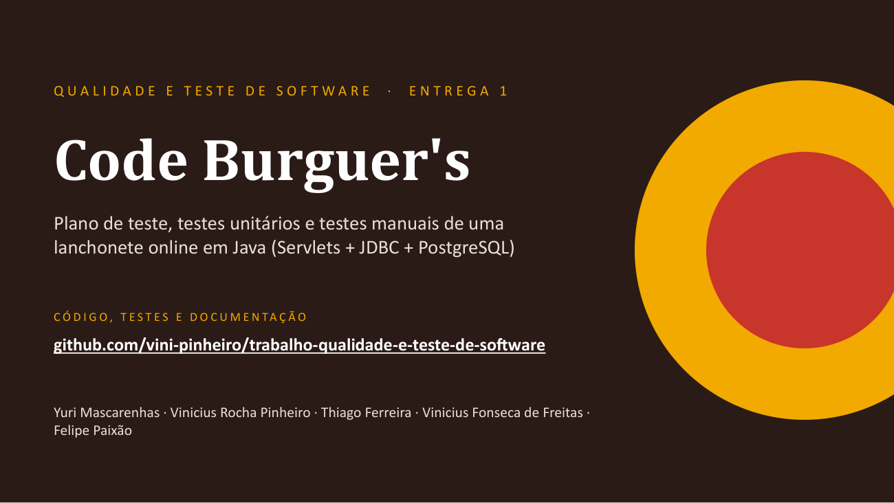
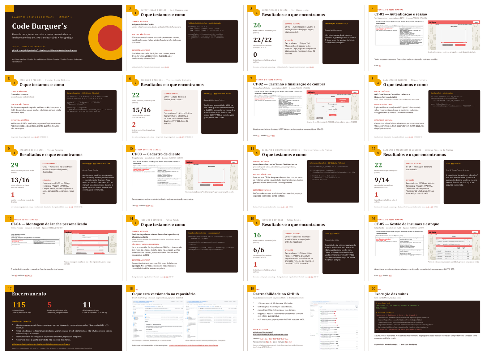

# Code Burguer's — Qualidade e Teste de Software

Projeto da disciplina de **Qualidade e Teste de Software**, desenvolvido sobre o sistema legado **APS-04-Lanchonete-Online-em-Java** (aplicação web para pedidos em uma lanchonete online, com cadastro de clientes, montagem personalizada de lanches, carrinho/checkout e painel administrativo de estoque, cardápio e relatórios).

Ao longo das entregas da disciplina, o repositório recebeu avaliação de qualidade pela **ISO/IEC 25010**, suítes automatizadas em múltiplos níveis (unitários, defeitos conhecidos, mutação, integração e sistema E2E), refatorações de testabilidade e saneamento orientadas pelo **SonarQube Cloud** e pipeline de integração contínua no **GitHub Actions**.

---

## Sumário

- [1. Visão Geral e Stack de Qualidade](#1-visão-geral-e-stack-de-qualidade)
- [2. Estratégia e Organização das Suítes de Teste](#2-estratégia-e-organização-das-suítes-de-teste)
- [3. Como Executar Cada Suíte (Passo a Passo)](#3-como-executar-cada-suíte-passo-a-passo)
- [4. Principais Melhorias e Qualidade Contínua](#4-principais-melhorias-e-qualidade-contínua)
- [5. Como Subir a Aplicação Localmente (Docker Compose)](#5-como-subir-a-aplicação-localmente-docker-compose)
- [6. Documentação, Entregas e Artefatos do Repositório](#6-documentação-entregas-e-artefatos-do-repositório)
- [7. Screenshots da Aplicação](#7-screenshots-da-aplicação)

---

## 1. Visão Geral e Stack de Qualidade

O projeto preserva o layout legado NetBeans (`src/java/` para código de produção, `src/test/java/` para testes e `web/` para recursos web e `web/WEB-INF/web.xml`), empacotado em `.war` com compilação estrita para **Java 8 (`1.8`)**.

| Camada / Finalidade | Tecnologia / Ferramenta | Versão / Configuração no Projeto |
|---|---|---|
| Linguagem e Runtime | Java (JDK 8 / OpenJDK 8) | `maven.compiler.source` e `target` = `1.8`, encoding `UTF-8` |
| Build e Gerenciamento | Apache Maven | `3.8.4` (`maven:3.8.4-openjdk-8` via Docker), `maven-war-plugin` `3.3.2`, `maven-compiler-plugin` `3.8.1` |
| Backend Web e JSON | Java Servlets, JSTL, Gson e `org.json` | `javax.servlet-api` `3.1.0` (`provided`), `jstl` `1.2`, `gson` `2.8.9`, `org.json` `20210307` |
| Servidor de Aplicação | Apache Tomcat 8.5 | Imagem `tomcat:8.5-jre8` (`Dockerfile` multi-stage substituindo o antigo GlassFish 4) |
| Banco de Dados e JDBC | PostgreSQL 13 e Driver PostgreSQL | Imagem `postgres:13` inicializada com `banco.sql`; driver `org.postgresql:postgresql` `42.2.5` |
| Testes Unitários e Mocks | JUnit 5, Mockito e Maven Surefire | `junit-jupiter` `5.8.2`, `mockito-core` / `mockito-junit-jupiter` `4.6.1`, `maven-surefire-plugin` `2.22.2` |
| Cobertura Estrutural | JaCoCo (`jacoco-maven-plugin`) | `0.8.11` com `jacoco:check` na fase `verify` (mínimo de **80% de cobertura de ramos** nas classes configuradas) |
| Teste de Mutação | PITest (`pitest-maven`) | `1.15.3` + `pitest-junit5-plugin` `1.2.1` (compatível com Java 8, mutadores `DEFAULTS`) |
| Testes de Integração | Maven Failsafe | `maven-failsafe-plugin` `2.22.2` (`<skipITs>true</skipITs>` por padrão; perfil `-Pintegracao`) |
| Testes End-to-End (E2E) | Selenium WebDriver + Chrome Headless | `selenium-java` `4.13.0` (Java 8) via `RemoteWebDriver` em `selenium/standalone-chrome` (perfil `-Pe2e`) |
| Containerização | Docker e Docker Compose | `Dockerfile`, `docker-compose.yml` e stack de produção em `deploy/compose.vps.yml` |
| CI/CD e Inspeção Contínua | GitHub Actions e SonarQube Cloud | Workflow `.github/workflows/build.yml` (runner JDK 17 para o scanner, target 1.8) -> `sonarcloud.io` |

---

## 2. Estratégia e Organização das Suítes de Teste

A estratégia de testes foi estruturada em cinco níveis complementares, isolando as suítes que dependem de infraestrutura externa (PostgreSQL 13, Tomcat 8.5 e Selenium) ou que expõem defeitos abertos por meio de perfis Maven no `pom.xml`.

| Nível | Padrão de Arquivos | Executor / Perfil Maven | Escopo e Infraestrutura | Quantidade na Branch |
|---|---|---|---|---|
| **Unitário** | `**/*Test.java` | Surefire (padrão) | Classes `DAO`, `Helpers`, `Controllers` e `Service` isoladas com Mockito; gera e valida cobertura no JaCoCo | **277** testes verdes (13 classes) |
| **Defeitos Conhecidos** | `@Tag("defeito-conhecido")` | `-Pdefeitos` (ou `-Pintegracao,defeitos` / `-Pe2e,defeitos`) | Testes mantidos vermelhos de propósito para documentar defeitos reais preservados do sistema legado | **8** unitários + **3** IT + **4** E2E |
| **Mutação** | `*Test` sobre classes-alvo | `org.pitest:pitest-maven:mutationCoverage` | Mede a efetividade da suíte unitária contra mutações no bytecode Java 8 (exclui `defeito-conhecido`) | Alvo padrão: `Service.MontagemLancheService` |
| **Integração** | `**/*IT.java` | Failsafe (`-Pintegracao`) | DAOs, helpers e servlets contra **PostgreSQL 13** real inicializado com `banco.sql` | **25** testes verdes + 3 defeitos (5 classes) |
| **Sistema (E2E)** | `**/*E2E.java` | Failsafe (`-Pe2e`) | Fluxos completos no navegador via **Selenium Chrome** contra **Tomcat 8.5** + **PostgreSQL 13** (padrão POM) | **8** testes verdes + 4 defeitos (3 classes) |

### Detalhamento por Nível

1. **Testes Unitários (`src/test/java/` — `*Test.java`)**
   - Executam sem banco de dados nem servidor web, utilizando mocks via Mockito (`@ExtendWith(MockitoExtension.class)`) e streams em memória para simular requisições HTTP (`CorpoRequisicao`).
   - Classes cobertas:
     - `DAO`: `DaoClienteTest` (45), `DaoLancheTest` (45), `DaoIngredienteTest` (13), `DaoTokenTest` (11).
     - `Helpers`: `ValidadorCookieTest` (28), `ValidadorCookieLimitesTest` (15), `EncryptadorMD5Test` (15).
     - `Controllers`: `CadastroTest` (26), `ComprarRegrasTest` (25), `SalvarLancheClienteTest` (14), `ComprarTest` (8), `IngredienteControllersTest` (7).
     - `Service`: `MontagemLancheServiceTest` (25).
   - O `jacoco-maven-plugin` (`0.8.11`) gera relatórios em `target/site/jacoco/index.html` (e `jacoco.xml`) e impõe na fase `verify` (`jacoco:check`) cobertura mínima de **80% de ramos (`BRANCH`)** em `Service.MontagemLancheService` (parametrizável via `-Djacoco.check.classes`) e `DAO.DaoIngrediente`.

2. **Testes de Defeitos Conhecidos (`@Tag("defeito-conhecido")` / perfil `-Pdefeitos`)**
   - A suíte padrão exclui a tag `defeito-conhecido` (`<grupos.excluidos>defeito-conhecido</grupos.excluidos>`) para que o build principal (`mvn clean verify` e `Dockerfile`) não quebre.
   - Esses testes **falham propositalmente** porque validam o comportamento correto esperado frente a defeitos reais preservados do código legado (como cálculos sem multiplicação por quantidade, uso de ID do JSON no lugar do cookie em `comprar`, concatenação SQL em `DaoCliente`, ausência de validação de campos vazios/negativos, não vinculação de ingredientes em `SalvarLancheCliente`, duplicidade de usuário, corrupção de acentos e ausência de expiração/segregação de token no servidor).
   - Assim que um defeito for corrigido em produção, o teste correspondente passa a verde automaticamente.
   - Distribuição atual:
     - Unitários (`-Pdefeitos`): 8 testes (`CadastroTest` [3], `ComprarRegrasTest` [2], `DaoClienteTest` [1], `IngredienteControllersTest` [1], `SalvarLancheClienteTest` [1]).
     - Integração (`-Pintegracao,defeitos`): 3 testes (`ValidadorCookieIT` [2], `CadastroIT` [1]).
     - E2E (`-Pe2e,defeitos`): 4 testes (`CadastroE2E` [4]).

3. **Testes de Mutação (PITest)**
   - Configurado com `pitest-maven:1.15.3` e `pitest-junit5-plugin:1.2.1` usando mutadores `DEFAULTS`, ignorando `@Tag("defeito-conhecido")` e gerando relatórios HTML e XML em `target/pit-reports/`.
   - Por padrão no `pom.xml`, analisa `Service.MontagemLancheService`, podendo ser direcionado para qualquer classe via `-Dpitest.targetClasses=...`.

4. **Testes de Integração (`**/*IT.java` — perfil `-Pintegracao`)**
   - Desativados no build padrão (`<skipITs>true</skipITs>`) e executados pelo Maven Failsafe contra um **PostgreSQL 13** real inicializado com `banco.sql`.
   - Classes: `DaoIngredienteIT` (8), `ValidadorCookieIT` (7 + 2 defeitos), `DaoPedidoIT` (4), `CadastroIT` (3 + 1 defeito) e `ComprarIT` (3).
   - Cada teste cria massa isolada com prefixo/sufixo `UUID` no `@BeforeEach` e remove todos os registros inseridos na ordem inversa de chave estrangeira no `@AfterEach`, garantindo zero resíduos no banco.

5. **Testes End-to-End (`src/test/java/e2e/` — `*E2E.java`, perfil `-Pe2e`)**
   - Executam fluxos reais de ponta a ponta no navegador Chrome Headless (`1440x900`) via `RemoteWebDriver` contra o WAR implantado no **Tomcat 8.5** conectado ao **PostgreSQL 13**, combinando ações de interface (padrão **Page Object Model** em `src/test/java/e2e/pages/`), capturas de tela e conferência/limpeza direta via JDBC.
   - Classes de teste: `EstoqueE2E` (4 — CT-05), `CheckoutE2E` (3 — CT-02) e `CadastroE2E` (1 + 4 defeitos — CT-03).
   - Page Objects: `AreaClientePage`, `CadastroPage`, `CardapioPage`, `CarrinhoCheckoutPage`, `EstoquePage`, `LoginFuncionarioPage`, `LoginPage` e `PainelIngredientePage`.

### Divisão de Módulos e Equipe

| Integrante | Módulo | Principais Classes Sob Teste / Refatoração | Caso Manual |
|---|---|---|---|
| Yuri Mascarenhas | Autenticação e sessão | `Helpers.ValidadorCookie`, `DAO.DaoToken` | CT-01 |
| Vinicius Rocha Pinheiro | Carrinho, pedidos e checkout | `Controllers.comprar`, `DAO.DaoPedido` | CT-02 |
| Thiago Ferreira | Gestão de clientes e endereços | `DAO.DaoCliente`, `Controllers.cadastro`, `Helpers.EncryptadorMD5` | CT-03 |
| Vinicius Fonseca de Freitas | Cardápio e montagem de lanches | `Controllers.SalvarLancheCliente`, `DAO.DaoLanche`, `Service.MontagemLancheService` | CT-04 |
| Felipe Paixão | Estoque e insumos | `DAO.DaoIngrediente`, `Controllers.salvarIngrediente`, `Controllers.alterarIngrediente` | CT-05 |

---

## 3. Como Executar Cada Suíte (Passo a Passo)

Todos os comandos abaixo podem ser executados diretamente com **Java 8 + Maven 3.8+** instalados localmente ou dentro da imagem oficial `maven:3.8.4-openjdk-8` via Docker.

> **Nota sobre permissões em Linux:** ao rodar `maven:3.8.4-openjdk-8` no Linux, você pode adicionar `-u "$(id -u):$(id -g)"` no `docker run` caso queira que os arquivos gerados em `target/` pertençam ao seu usuário local.

### 3.1. Testes Unitários + Relatório e Verificação JaCoCo (`jacoco:check`)

Executa os 277 testes unitários (excluindo `defeito-conhecido`), gera o relatório de cobertura e valida o limite mínimo de 80% de ramos no JaCoCo:

```bash
mvn -B clean verify
```

Via Docker (sem precisar de Java/Maven locais):

```bash
docker run --rm -v "$PWD":/app -w /app maven:3.8.4-openjdk-8 mvn -B clean verify
```

- Relatórios Surefire: `target/surefire-reports/`
- Relatório HTML/XML do JaCoCo: `target/site/jacoco/index.html` e `target/site/jacoco/jacoco.xml`

---

### 3.2. Testes de Defeitos Conhecidos (`-Pdefeitos`)

Executa exclusivamente os testes unitários marcados com `@Tag("defeito-conhecido")`. **O resultado esperado é falha (`BUILD FAILURE`, 8 testes vermelhos)** enquanto os defeitos legados permanecerem abertos:

```bash
mvn -B -Pdefeitos test
```

Via Docker:

```bash
docker run --rm -v "$PWD":/app -w /app maven:3.8.4-openjdk-8 mvn -B -Pdefeitos test
```

*(Opcional)* Para rodar também os cenários de defeitos conhecidos de integração ou E2E em seus respectivos ambientes Docker, combine os perfis: `-Pintegracao,defeitos` ou `-Pe2e,defeitos`.

---

### 3.3. Testes de Mutação (PITest)

Executa a análise de mutação em Java 8 com geração de relatórios em `target/pit-reports/index.html`:

```bash
mvn -B test-compile org.pitest:pitest-maven:mutationCoverage
```

Via Docker:

```bash
docker run --rm -v "$PWD":/app -w /app maven:3.8.4-openjdk-8 mvn -B test-compile org.pitest:pitest-maven:mutationCoverage
```

*(Opcional)* Para avaliar outra classe específica e seus testes correspondentes, sobrescreva as propriedades definidas no `pom.xml`:

```bash
docker run --rm -v "$PWD":/app -w /app maven:3.8.4-openjdk-8 \
  mvn -B test-compile org.pitest:pitest-maven:mutationCoverage \
  -Dpitest.targetClasses=Controllers.comprar \
  -Dpitest.targetTests=Controllers.Comprar*Test
```

---

### 3.4. Testes de Integração (`-Pintegracao`) com Docker + PostgreSQL 13

Os testes `*IT` conectam-se via `DAO.DaoUtil` ao host `db`, porta `5432`, banco `lanchonete`, usuário `postgres` e senha `123456`. O passo a passo abaixo cria uma rede Docker isolada, inicializa o PostgreSQL 13 com `banco.sql`, executa os testes de integração e remove os recursos ao final:

```bash
# 1. Criar rede Docker isolada
docker network create qts-net

# 2. Subir PostgreSQL 13 com alias "db", credenciais do DaoUtil.java e schema banco.sql
docker run -d --name qts-db --network qts-net --network-alias db \
  -e POSTGRES_DB=lanchonete \
  -e POSTGRES_USER=postgres \
  -e POSTGRES_PASSWORD=123456 \
  -v "$PWD/banco.sql:/docker-entrypoint-initdb.d/banco.sql:ro" \
  postgres:13

# 3. Aguardar o PostgreSQL ficar pronto para conexões
until docker exec qts-db pg_isready -h 127.0.0.1 -U postgres -d lanchonete; do
  sleep 2
done

# 4. Executar os testes unitários + suíte de integração (*IT) com Failsafe
docker run --rm --network qts-net -v "$PWD":/app -w /app \
  maven:3.8.4-openjdk-8 mvn -B -Pintegracao verify

# 5. Limpeza do container e da rede
docker rm -f qts-db && docker network rm qts-net
```

---

### 3.5. Testes End-to-End (`-Pe2e`) com Docker (Tomcat 8.5 + PostgreSQL 13 + Selenium Chrome)

Os testes `*E2E` esperam por padrão a aplicação em `http://e2e-app:8080`, o Selenium Grid em `http://selenium:4444/wd/hub` (configuráveis via `-De2e.baseUrl` e `-De2e.seleniumUrl`) e o banco no alias `db`. O alias `e2e-app` evita o redirecionamento forçado para HTTPS (HSTS preload) aplicado pelo Chromium moderno ao TLD `.app`.

```bash
# 1. Criar rede Docker isolada para a suíte E2E
docker network create qts-e2e-net

# 2. Subir PostgreSQL 13 com alias "db" e schema banco.sql
docker run -d --name qts-e2e-db --network qts-e2e-net --network-alias db \
  -e POSTGRES_DB=lanchonete \
  -e POSTGRES_USER=postgres \
  -e POSTGRES_PASSWORD=123456 \
  -v "$PWD/banco.sql:/docker-entrypoint-initdb.d/banco.sql:ro" \
  postgres:13

until docker exec qts-e2e-db pg_isready -h 127.0.0.1 -U postgres -d lanchonete; do
  sleep 2
done

# 3. Construir e subir a aplicação no Tomcat 8.5 com alias "e2e-app"
docker build -t lanchonete-e2e .
docker run -d --name qts-e2e-app --network qts-e2e-net --network-alias e2e-app \
  lanchonete-e2e

# 4. Subir o container Selenium Standalone Chrome com alias "selenium"
docker run -d --name qts-selenium --network qts-e2e-net --network-alias selenium \
  --shm-size=2g selenium/standalone-chrome

# 5. Aguardar Tomcat e Selenium ficarem disponíveis na rede
docker run --rm --network qts-e2e-net curlimages/curl:latest sh -c \
  'until curl -fsS http://e2e-app:8080/ >/dev/null && curl -fsS http://selenium:4444/status >/dev/null; do sleep 2; done'

# 6. Executar a suíte E2E (*E2E) com Maven Failsafe
docker run --rm --network qts-e2e-net -v "$PWD":/app -w /app \
  maven:3.8.4-openjdk-8 mvn -B -Pe2e verify

# 7. Limpeza dos containers e da rede
docker rm -f qts-selenium qts-e2e-app qts-e2e-db && docker network rm qts-e2e-net
```

> **Dica:** as propriedades `-De2e.baseUrl`, `-De2e.seleniumUrl` e `-De2e.screenshotsDir` podem ser passadas na linha de comando do Maven caso deseje apontar para outra URL ou diretório de screenshots.

---

## 4. Principais Melhorias e Qualidade Contínua

### Refatorações para Testabilidade e Arquitetura

- **Injeção de Dependência via Construtores (_Constructor Chaining_):** DAOs (`DaoToken`, `DaoEndereco`, `DaoIngrediente`, `DaoPedido`, `DaoBebida`, `DaoLanche`, `DaoCliente`), helpers (`ValidadorCookie`) e servlets (`comprar`, `cadastro`, `SalvarLancheCliente`, `salvarIngrediente`, `alterarIngrediente`) passaram a aceitar dependências (`Connection`, DAOs, `ValidadorCookie`, `EncryptadorMD5`) por construtor, preservando os construtores públicos vazios exigidos pelo Tomcat em produção.
- **Extração de Camada de Serviço:** criação de `Service.MontagemLancheService` para concentrar e validar regras de montagem de lanches personalizados com precisão decimal (`BigDecimal`).

### Saneamento de Código e Correções do SonarQube Cloud

- **Redução de Complexidade Cognitiva e Modularização:** extração de métodos coesos e pequenos em classes críticas como `Controllers.comprar` (decomposição de `processRequest` em `validarCookies`, `lerDadosJson`, `processarItens`, `processarItem`, `salvarEVincularPedido` e `escreverResposta`) e `Controllers.SalvarLancheCliente` (também padronizada no `web/WEB-INF/web.xml`).
- **Redução de Duplicação e Código Morto:** extração de constantes de colunas/chaves JSON e métodos auxiliares de mapeamento (`lerLinha`/`lerTodos` em `DaoIngrediente`), remoção de imports não utilizados e eliminação de checagens redundantes (como verificações de leitor não nulo logo após instanciação).
- **Prevenção de Bugs, Segurança e Confiabilidade:**
  - Proteção contra possível `NullPointerException` na leitura de payloads (`Objects.toString(leitor.readLine(), "")` em `SalvarLancheCliente`, regra `S2259`).
  - Parametrização de consulta SQL por nome com `PreparedStatement` (`?`) e substituição de `SELECT *` por colunas explícitas em `DaoIngrediente`, além de uso de `try-with-resources` para fechamento seguro de `PreparedStatement`, `ResultSet` e `PrintWriter`.
  - Substituição de concatenação de strings em laço por `StringBuilder` em `EncryptadorMD5`, marcação de dependências como `private final` em servlets/DAOs e troca de `System.out.println` e blocos `catch` vazios por `java.util.logging.Logger`.

### Integração Contínua (GitHub Actions + SonarQube Cloud)

- O workflow [`.github/workflows/build.yml`](.github/workflows/build.yml) executa automaticamente em `push` (`main`, `master`, `develop`) e em `pull_request`:
  1. Checkout completo (`fetch-depth: 0`) e setup do Temurin JDK 17 (exigido pelo scanner do Sonar) com cache Maven.
  2. Execução de `mvn -B clean verify` (compilação Java 1.8, suíte unitária completa, relatório XML do JaCoCo e gate `jacoco:check`).
  3. Análise no **SonarQube Cloud** (`https://sonarcloud.io`, projeto `vini-pinheiro_trabalho-qualidade-e-teste-de-software`, organização `vini-pinheiro`) consumindo `target/site/jacoco/jacoco.xml`.
- **Quality Gate nos Pull Requests** (critérios para código novo):
  - **Cobertura >= 80%**
  - **Duplicação <= 3%**
  - **0 novos bugs, 0 vulnerabilidades e 0 security hotspots**

---

## 5. Como Subir a Aplicação Localmente (Docker Compose)

### Pré-requisitos

- [Docker](https://www.docker.com/get-started) e [Docker Compose](https://docs.docker.com/compose/install/)
- *(Opcional, para execução fora de containers)* [Java 8](https://adoptopenjdk.net/) e [Maven](https://maven.apache.org/)

### Passos para executar

1. **Clone o repositório:**

   ```bash
   git clone https://github.com/vini-pinheiro/trabalho-qualidade-e-teste-de-software.git
   cd trabalho-qualidade-e-teste-de-software
   ```

2. **Suba os containers com Docker Compose:**

   ```bash
   docker-compose up --build -d
   ```

   Isso cria e inicia o banco de dados **PostgreSQL 13** (inicializado com `banco.sql`) e o servidor **Tomcat 8.5** com a aplicação empacotada pelo `Dockerfile`.

3. **Acesse a aplicação:**
   - URL local: [http://localhost:8080](http://localhost:8080)
   - Usuário administrador padrão criado pelo `banco.sql`: usuário `admin` / senha `admin`.

4. **Para parar e remover containers e volumes:**

   ```bash
   docker-compose down -v
   ```

> **Observações:**
> - Caso precise alterar configurações de inicialização do ambiente local, consulte `docker-compose.yml` e `banco.sql`.
> - A configuração de publicação em VPS (Tomcat + PostgreSQL + Nginx + Cloudflare Access) está documentada em [`deploy/README.md`](deploy/README.md).
> - Se houver problemas de cache no navegador ao testar o frontend, utilize `Ctrl+F5` ou limpe o cache manualmente.

---

## 6. Documentação, Entregas e Artefatos do Repositório

### Entrega 1 — Apresentação, Relatório e Casos Manuais

[](docs/entrega-1/apresentacao/apresentacao-entrega-1.pptx)

Vinte e um slides: abertura, três por integrante (o que foi testado, resultados e evidência do caso manual), encerramento e quatro anexos finais (estrutura do repositório, issues, saída real do Maven e registros de uso de IA).



- [Baixar a apresentação (.pptx)](docs/entrega-1/apresentacao/apresentacao-entrega-1.pptx)
- [Roteiro de falas (.pdf)](docs/entrega-1/apresentacao/roteiro-apresentacao.pdf) — formato teleprompter, uma página por integrante
- [Relatório da Entrega 1](docs/entrega-1/README.md) — baseline da Entrega 1 (115 unitários, 5 defeitos conhecidos, 5 casos manuais com 23 passos `PASSOU` e 13 `FALHOU`, e issues `#20` a `#25`)
- [Casos de teste manuais (com prints)](docs/entrega-1/apresentacao/casos-manuais)
- [Evidências dos anexos](docs/entrega-1/apresentacao/anexos)
- [Plano de Testes (Google Docs)](https://docs.google.com/document/d/1MT2I238OlATRWofvbea8ut1F0oSDA92Siztl87TmjpI/edit?usp=drive_link)
- Documentos dos Casos de Teste:
  - [CT-01 — Autenticação (Yuri Mascarenhas)](docs/entrega-1/casos-de-testes/CT-01-Autenticacao-Yuri-Mascarenhas.docx)
  - [CT-02 — Carrinho e Compra (Vinicius Rocha Pinheiro)](docs/entrega-1/casos-de-testes/CT-02-Carrinho-e-Compra-Vinicius-Rocha-Pinheiro.docx)
  - [CT-03 — Cadastro de Cliente (Thiago Ferreira)](docs/entrega-1/casos-de-testes/CT-03-Cadastro-de-Cliente-Thiago-Ferreira.docx)
  - [CT-04 — Montagem de Lanche (Vinicius Fonseca)](docs/entrega-1/casos-de-testes/CT-04-Montagem-de-Lanche-Vinicius-Fonseca.docx)
  - [CT-05 — Insumos e Estoque (Felipe Paixão)](docs/entrega-1/casos-de-testes/CT-05-Insumos-e-Estoque-Felipe-Paixao.docx)

### Entrega 2, Qualidade ISO/IEC 25010 e Registros de IA

- [Pasta do Drive do Trabalho](https://drive.google.com/drive/folders/1s0WvyWbX6CSu7418xDItmKTyxbFoLRs1?usp=sharing)
- [Avaliação de Qualidade — ISO/IEC 25010:2023](docs/iso/qualidade-iso25010.md)
- [Evidências do Selenium WebDriver (Entrega 2)](docs/entrega-2/selenium)
- [Evidências do SonarQube Cloud (Entrega 2)](docs/entrega-2/sonar)
- [Requisitos de Montagem de Lanche](docs/entrega-2/Requisitos_Lanche_Vinicius_Fonseca.md)
- [Artefatos da Entrega 2 — Thiago Ferreira](docs/entrega-2/thiago-ferreira)
- [Registros de Uso de IA (`docs/ai/`)](docs/ai/README.md)

---

## 7. Screenshots da Aplicação


